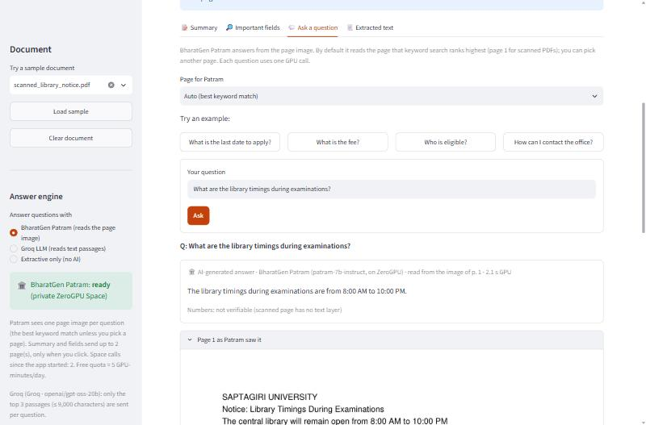
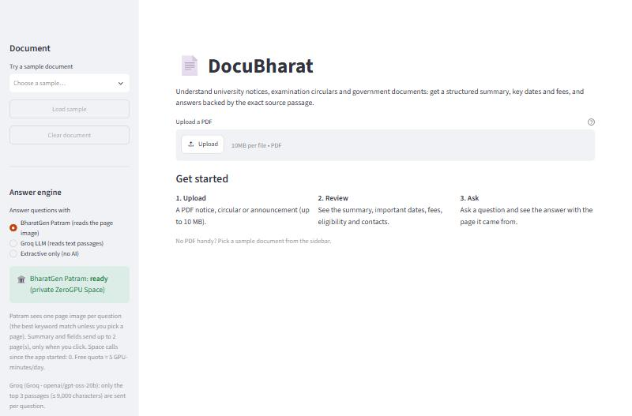
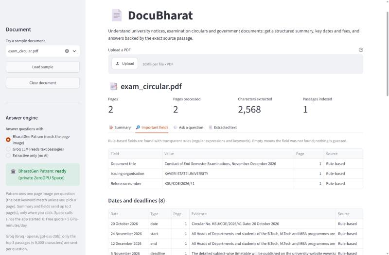
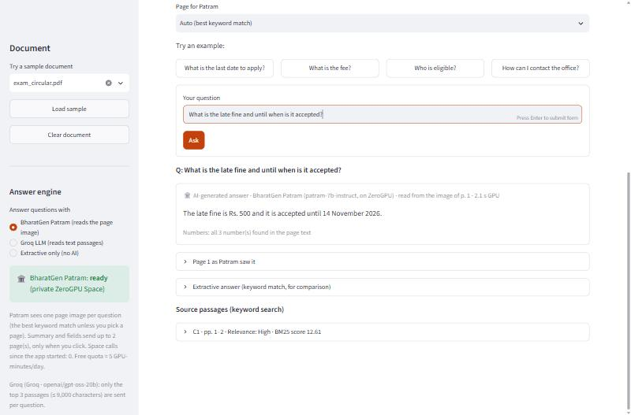
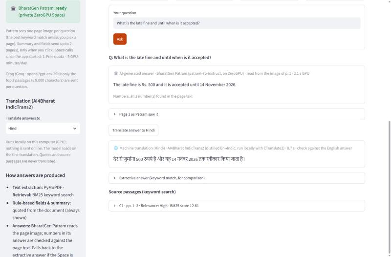
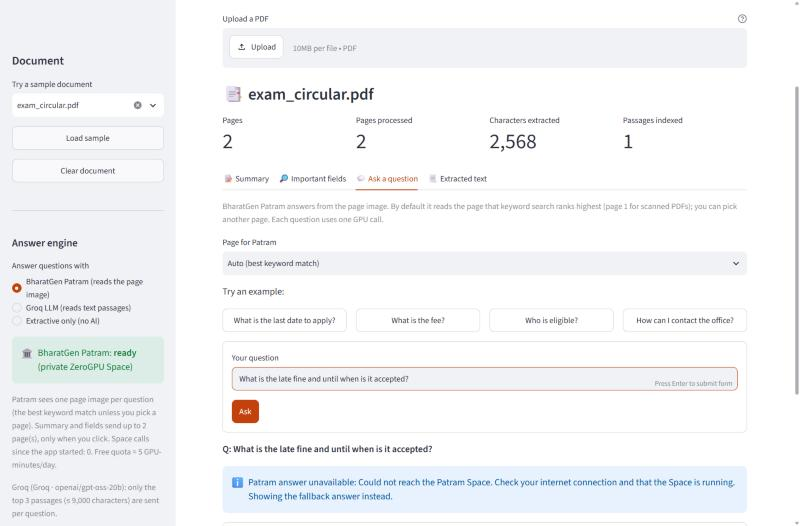
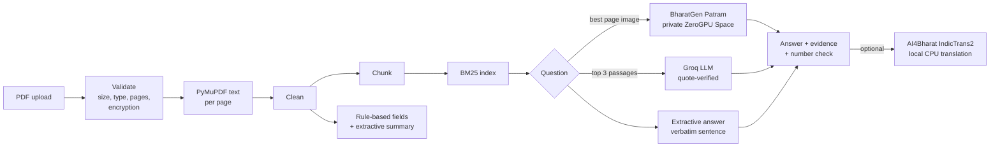

# DocuBharat: Indian Document Understanding Assistant

DocuBharat reads university notices, examination circulars, scholarship and fee notices and government documents (PDF), and helps people understand them:

- **Summarises** a document in structured points.
- **Extracts key fields:** title, issuing organisation, reference number, dates and deadlines, fees, eligibility, contacts and action items.
- **Answers questions** with the source page and passage shown, and says so when the answer is not in the document.
- **Reads scanned PDFs** (image-only pages) with BharatGen Patram.
- **Translates answers** into 12 Indian languages with AI4Bharat IndicTrans2, locally on the CPU.

Built for the CS3235 LLM / Multimodal AI lab, topic *"Indian Document Understanding Tool"* (BharatGen Patram + AI4Bharat IndicTrans2). It runs on a Windows laptop with 16 GB RAM and **no GPU**.



## Models used (and how)

| Model | Organisation | How DocuBharat uses it | Runs where | Licence |
|---|---|---|---|---|
| **Patram** (`bharatgenai/patram-7b-instruct`, rev. `patram1.1`) | **BharatGen** | Document VQA on **page images**: answers, summaries, fields; the only component that reads scanned pages | Your **private Hugging Face ZeroGPU Space** (free tier) | Apache 2.0 |
| **IndicTrans2** (distilled En→Indic, official CTranslate2 int8 export) | **AI4Bharat** | Translates answers into Hindi, Bengali, Tamil, Telugu, Marathi, Gujarati, Kannada, Malayalam, Punjabi, Odia, Assamese, Urdu | **Locally on the CPU** (212 MB, ~0.5 GB RAM) | MIT |
| `openai/gpt-oss-20b` via Groq | (comparison only) | Text-based answers with verified quotes; *not* part of the AI4Bharat/BharatGen requirement | Groq API (free tier) | weights Apache 2.0 per OpenAI (not re-verified here); Groq's terms apply |

Every model is **optional**: without any of them the app still extracts text, answers with verbatim sentences and extracts fields with rules. Patram is too large for this laptop (≈ 16 GB of BF16 weights) and has no hosted API, which is why it runs on a free GPU Space (see [docs/patram_space_plan.md](docs/patram_space_plan.md)). Full details for each integration (sources, versions, authentication, limits, fallbacks) are in [docs/integrations.md](docs/integrations.md).

## Quick start (Windows, core app)

Requires **Python 3.11+** (tested with 3.12.10).

```bash
python -m venv .venv
```
```bash
.venv\Scripts\activate
```
```bash
python -m pip install -r requirements.txt
```
```bash
streamlit run app.py
```

Open http://localhost:8501 and pick a sample document in the sidebar. This core install needs no API key, no model download and no GPU.

Optional: copy `.env.example` to `.env` to change limits or enable the components below. **Never commit `.env`.**

## Optional components

### BharatGen Patram (recommended: the brief's vision-language model)

1. Accept the access terms at https://huggingface.co/bharatgenai/patram-7b-instruct and create a **read** token at https://huggingface.co/settings/tokens. Your account must be over 30 days old to host a free ZeroGPU Space.
2. Create a **private** Space (SDK *Gradio*, hardware *ZeroGPU*) and upload the three files in [`patram_space/`](patram_space/). Add a Space secret `HF_TOKEN` with your read token.
3. Install the client and configure `.env`:
   ```bash
   python -m pip install -r requirements-patram.txt
   ```
   In `.env`: `HF_TOKEN=hf_…` and `PATRAM_SPACE_ID=<your-username>/<space-name>`.
4. Check it with 3 calls on the synthetic samples:
   ```bash
   python scripts/check_patram_space.py
   ```

Free ZeroGPU accounts get **5 GPU-minutes/day**, which is about 50–100 Patram calls. A sleeping Space takes a minute to wake up; the app retries once and otherwise falls back to the text-based answer. Step-by-step notes and measured results are in [docs/patram_space_plan.md](docs/patram_space_plan.md).

### AI4Bharat IndicTrans2 (local translation)

1. Install the packages (≈ 25 MB; no PyTorch, no compiler):
   ```bash
   python -m pip install -r requirements-translation.txt
   ```
   ```bash
   python -m pip install --no-deps -r requirements-translation-nodeps.txt
   ```
2. Accept the terms of https://huggingface.co/datasets/ai4bharat/BPCC (same `HF_TOKEN`).
3. Fetch the model once. This streams the official 2.78 GB archive and keeps only the 218 MB int8 model in `models/`:
   ```bash
   python scripts/setup_indictrans2.py
   ```

Feasibility study and measurements: [docs/indictrans2_feasibility.md](docs/indictrans2_feasibility.md).

### Groq (optional comparison engine)

Put a free key from https://console.groq.com/keys in `.env` as `LLM_API_KEY=…`, then test it:

```bash
python scripts/check_llm.py
```

## Demo walkthrough

1. **Start.** The sidebar shows the sample documents, the **answer engine** (BharatGen Patram / Groq / extractive) and the translation language. Components that are not configured say why.
   
2. **Load `exam_circular.pdf`.** The **Summary** tab shows the rule-based summary and a *Summarise with Patram* button. The **Important fields** tab lists title, organisation, reference, dates, fees and contacts, each with its page and evidence.
   
3. **Ask "What is the late fine and until when is it accepted?"** Patram reads page 1, chosen by keyword search, and answers *"The late fine is Rs. 500 and it is accepted until 14 November 2026."* All 3 numbers are found in the page text. Under the answer: the page image Patram saw, the extractive answer for comparison, and the source passage.
   
4. **Translate.** Choose *Hindi* in the sidebar and click *Translate answer to Hindi*. IndicTrans2 runs locally (0.7 s) and the English answer stays visible. A warning appears if any date or amount is lost in translation.
   
5. **Load `scanned_library_notice.pdf`** (no text layer). Text-based features explain that they cannot run; Patram answers from the image (*"8:00 AM to 10:00 PM"*) and marks the answer *not verifiable*, because there is no text to check against.
6. **Failure handling.** If the Patram Space is asleep, out of quota or unreachable, the app says so and shows the fallback answer instead.
   

## Architecture



Components, the question flow, the module list, design decisions and data handling are covered in [docs/architecture.md](docs/architecture.md).

## Evaluation (40 cases, run 2026-10-31)

28 QA questions (factual, dates, fees, absent answers, ambiguous, noisy/paraphrased, scanned), field extraction on 6 documents (72 slots) and summaries of 6 documents (24 key facts). Full report: [docs/evaluation_report.md](docs/evaluation_report.md).

| | Extractive (no AI) | Groq | **BharatGen Patram** |
|---|---|---|---|
| QA accuracy (28) | 23 (82%) | 26 (93%) | **27 (96%)** |
| Scanned-page questions (2) | 0 | 0 | **2** |
| Correct "not in document" (5) | 4 | **5** | 4 |
| Field exact match (72 slots) | 100%* | 94% (100% relaxed) | 71% |
| Summary key facts (24) | 100%* | 96% | 88% |

\* The rule-based system was tuned on these same documents, so these scores are optimistic. With 28 questions the QA differences are not statistically significant (95% CIs overlap); the scanned-page advantage is the clear difference.

**IndicTrans2:** 29/30 translations (Hindi, Tamil, Bengali) preserved every number, and all were in the right script, at about 0.7 s per sentence. The one failure turned "Rs. 2,50,000" into "500" in Bengali; the app's number check flags this case.

Reproduce:

```bash
python scripts/run_evaluation.py --offline
```

This re-scores from the saved outputs, without API calls. Per-case results (ID, document, question, expected answer, supporting page/passage, actual output, correctness, failure category) are in [data/test_cases/results.csv](data/test_cases/results.csv).

## Tests

```bash
python -m pytest
```

**226 tests**, all offline: no API keys, no GPU quota and no network are used (the real-model translation test runs only if the model is downloaded). They cover:

- PDF validation (empty, malformed, encrypted, oversized, truncated, scanned)
- chunking and page mapping, retrieval, field extraction, unanswerable questions, source evidence
- LLM/Space failures: missing keys, 401/403, rate limits, timeouts, malformed replies, a sleeping Space
- prompt injection and secret leakage
- the Streamlit UI, run headlessly
- the evaluation scorer and the integrity of the ground truth

See [docs/testing_notes.md](docs/testing_notes.md).

## Repository layout

```
app.py                       Streamlit UI
src/                         pipeline, retrieval, fields, QA, Patram/Groq/IndicTrans2 clients, evaluation
patram_space/                Gradio app for the private ZeroGPU Space (BharatGen Patram)
third_party/indictrans2/     AI4Bharat inference engine (unmodified, MIT, pinned commit)
scripts/                     sample generator, setup and check scripts, evaluation runners
data/sample_documents/       7 synthetic PDFs (fictional; safe to redistribute)
data/test_cases/             40 test cases, model outputs, results, metrics
tests/                       pytest suite
docs/                        architecture, integrations, feasibility, evaluation, testing, screenshots
```

## Security and privacy

- Uploaded files are kept **in memory only** for the session; the app binds to `localhost` only.
- Secrets live only in `.env` (git-ignored). They are never logged or shown, and tests check this.
- What leaves your computer:
  - **Patram:** one page image per question, sent to your **private** Space.
  - **Groq:** at most the top 3 passages (≤ 9,000 characters).
  - **Translation:** nothing.
- Document text is treated as **untrusted data:** prompts label it as such, Markdown is escaped in the UI, and the app never follows instructions found in a PDF.
- Limits: 10 MB per file, 100 pages, request timeouts. Pathological text is processed in bounded time.

## Limitations

- **Indian-language documents are not yet accepted as input.** The pipeline reads English documents and translates *answers* into Indian languages; IndicTrans2 Indic→English would close this gap (needs another ~2.6 GB streamed download). Patram itself is English-only so far, per its model card.
- **Patram** misreads exact strings (reference numbers, e-mails), paraphrases or invents titles, ignores output-format instructions, and gave one confident wrong answer on an absent-answer question. Its number check cannot catch a correct number attached to the wrong item.
- **Patram depends on a free ZeroGPU Space:** 5 GPU-minutes/day, cold starts and an internet connection.
- **The evaluation is small** (40 cases, 7 synthetic English documents); the rule-based scores are optimistic (tuned on the same documents).
- **Translation quality** was checked automatically only (numbers, script), not by fluent human raters.
- **Keyword retrieval (BM25)** misses paraphrased questions when no model is used.

## How this project meets the CS3235 brief

The official rubric text was not provided to me, so this table maps the **topic brief** (topic 3) and the assignment requirements stated for this project. Please check it against your course's rubric.

| Requirement | Where it is met | Evidence |
|---|---|---|
| Upload notices, forms, government documents | Streamlit upload + 7 sample documents | `app.py`, `data/sample_documents/` |
| **Indian-language** documents | ⚠️ *Partly*: Indian-language **answers** via IndicTrans2; Indic-language **input** not yet supported | Limitations above |
| Extract fields | Rule-based, Patram and Groq field extraction, with page and evidence | Fields tab; `src/field_extractor.py`, `src/patram_tasks.py` |
| Summarise | Extractive, Patram and Groq summaries | Summary tab |
| Answer document questions | Extractive, Patram (page image) and Groq (passages); explicit "not found" | Q&A tab; `src/qa_engine.py` |
| **BharatGen Patram** vision-language model | Integrated via a private ZeroGPU Space; default engine | `src/patram_client.py`, `patram_space/`, screenshots 3 & 6 |
| **AI4Bharat IndicTrans2** | Integrated locally (official CT2 model + official engine) | `src/indic_translator.py`, screenshot 5 |
| Computer vision / OCR / document VQA / multimodal LLM | Patram answers from rendered page images, including scanned PDFs without OCR | Scanned-page results (2/2), screenshot 6 |
| Evaluation: **field-extraction accuracy** | 72-slot exact-match (+ relaxed) per system | `docs/evaluation_report.md` §4.3 |
| Evaluation: **QA accuracy** | 28 QA cases × 3 systems, with CIs | `docs/evaluation_report.md` §4.1 |
| 30–50 test cases | 40 cases with ID, document, task, expected answer, support, output, correctness, failure category | `data/test_cases/` |
| Source passages / evidence | Page and passage for every answer; page image for Patram; verified quotes for Groq | Q&A tab |
| Says when information is absent | Absent-answer category (5 cases per system) | Evaluation §4.1 |
| Runs on a 16 GB, CPU-only Windows laptop | No local LLM; IndicTrans2 int8 ≈ 0.5 GB; Patram remote | `docs/integrations.md` (measured) |
| Tests and reliability | 226 offline tests | `tests/`, `docs/testing_notes.md` |
| Documentation | README, architecture (Mermaid), integrations, evaluation, feasibility, testing | `docs/` |

## Licences and acknowledgements

- **PyMuPDF** is AGPL-3.0 (or commercial). Distributing this project therefore requires an AGPL-compatible licence for it. **This repository's own licence has not been chosen yet.**
- **IndicTrans2:** © AI4Bharat, MIT (`third_party/indictrans2/LICENSE`). Gala et al., *IndicTrans2*, TMLR 2023, https://arxiv.org/abs/2305.16307.
- **Patram:** © BharatGen, Apache 2.0, https://huggingface.co/bharatgenai/patram-7b-instruct.
- The sample documents are **synthetic and fictional**, created for this project.
