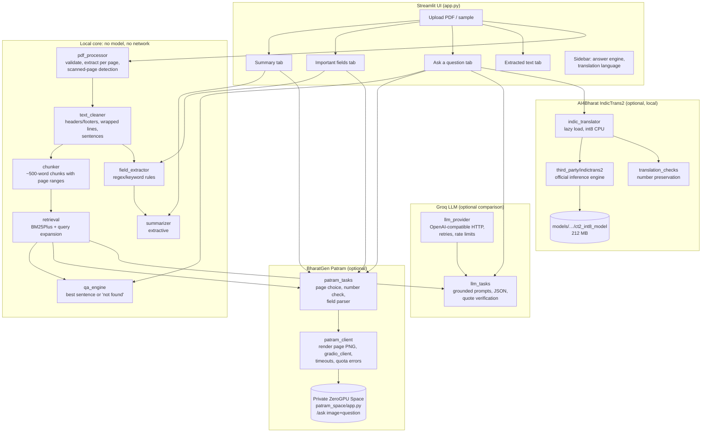
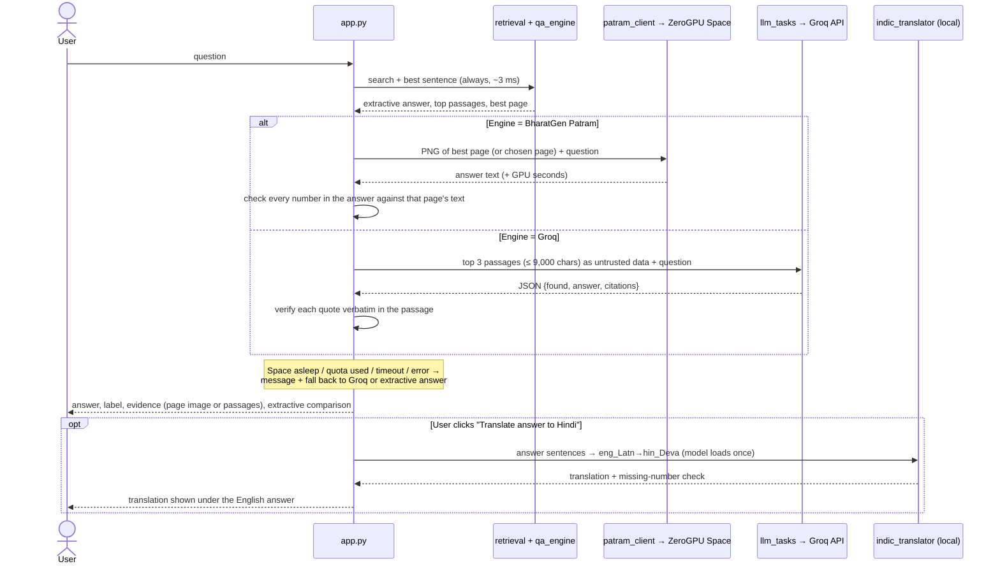

# DocuBharat: Architecture

DocuBharat is a single Streamlit application (`app.py`) over small, single-purpose Python modules in `src/`. The core pipeline runs locally with no model and no network. Three optional components add models, and each can be switched off without affecting the rest:

| Component | Model | Where it runs | Used for |
|---|---|---|---|
| **BharatGen Patram** | `bharatgenai/patram-7b-instruct` (vision-language) | user's private Hugging Face **ZeroGPU Space** (free tier) | answers, summary and fields from **page images**; scanned PDFs |
| **AI4Bharat IndicTrans2** | distilled En→Indic, CTranslate2 int8 | **locally on the CPU** | translating answers into 12 Indian languages |
| Groq (comparison) | `openai/gpt-oss-20b` | Groq API | answers, summary and fields from text passages, with verified quotes |

## 1. Components

## 2. Question-answering flow

## 3. Modules

| Module | Responsibility | Tests |
|---|---|---|
| `src/config.py` | Limits from env (10 MB, 100 pages, chunk size, top-k) | `test_robustness.py` |
| `src/pdf_processor.py` | Validate (type, size, header, encryption), extract per page, flag scanned pages | `test_pdf_processor.py` |
| `src/text_cleaner.py` | Running headers/footers, hyphenation, wrapped lines, sentence splitting | `test_chunker.py`, `test_robustness.py` |
| `src/chunker.py` | Word-window chunks that keep page ranges | `test_chunker.py` |
| `src/retrieval.py` | BM25Plus, tokeniser (incl. Indic scripts), small synonym expansion | `test_retrieval.py` |
| `src/field_extractor.py` | Rule-based title, organisation, reference, dates, amounts, contacts, eligibility, actions | `test_field_extractor.py` |
| `src/summarizer.py` | Extractive structured summary | `test_field_extractor.py` |
| `src/qa_engine.py` | Extractive answer or explicit "not found" | `test_qa_engine.py` |
| `src/pipeline.py` | Validate → extract → clean → chunk → index | several |
| `src/patram_client.py` | Page rendering, Space calls via `gradio_client`, user-safe errors | `test_patram.py` |
| `src/patram_tasks.py` | Page choice, number grounding, field/summary prompts and parser | `test_patram.py` |
| `src/indic_translator.py` | IndicTrans2 via AI4Bharat's engine, lazy int8 CPU load | `test_indic_translator.py` |
| `src/translation_checks.py` | Number preservation, sentence segmentation | `test_translation_checks.py` |
| `src/llm_provider.py` | OpenAI-compatible client: timeouts, retries, rate limits, no secret leakage | `test_llm_provider.py` |
| `src/llm_tasks.py` | Grounded prompts, JSON schemas, quote verification | `test_llm_tasks.py` |
| `src/ui_text.py` | Markdown escaping of untrusted document text | `test_robustness.py` |
| `src/evaluation.py` | 40-case evaluation: runners, cache, scoring | `test_evaluation.py` |
| `patram_space/` | The Gradio app deployed on the private ZeroGPU Space | live check script |
| `third_party/indictrans2/` | AI4Bharat inference code, unmodified (MIT, pinned commit) | via translator tests |

## 4. Design decisions

- **Text first, models optional.** Extraction, retrieval, rule-based fields and extractive answers never need a key or network, so the app always works.
- **One page per Patram question.** BM25 picks the page, which keeps GPU quota use to one call per question (free tier: 5 GPU-minutes/day). Answers are cached per document, page and question.
- **No local generative or embedding model.** BM25 instead of embeddings. Patram runs remotely. IndicTrans2 is the only local model: 212 MB int8, loaded only on the first translation.
- **Grounding everywhere:**
  - extractive answers are verbatim;
  - Groq must quote, and each quote is verified;
  - Patram's numbers are checked against the page text;
  - translations are checked for lost numbers.

  The source evidence is always shown next to AI output.
- **Untrusted document text.** Document text is never treated as instructions:
  - prompts wrap it in tags, label it as data and neutralise attempts to close the tags;
  - UI rendering escapes Markdown;
  - PyMuPDF does not execute embedded scripts.

## 5. Data handling and security

| Concern | Handling |
|---|---|
| Uploaded files | Kept in memory for the session only; never written to disk (page PNGs for Patram are written to a temporary folder that is deleted immediately) |
| Network exposure | Streamlit binds to `localhost` only (`.streamlit/config.toml`) |
| Secrets | Only in `.env` (git-ignored). Never logged; `repr` hides them; tests assert that keys never appear in errors or logs |
| What leaves the machine | Patram: one page image per question (or ≤ 2 pages for summary/fields, on click) to the user's **private** Space. Groq: top 3 passages (≤ 9,000 characters). Translation: nothing (local) |
| Error display | `showErrorDetails = "none"`: no tracebacks in the browser |
| Limits | 10 MB upload, 100 pages, regex work bounded on pathological text, LLM/Space timeouts |

## 6. Configuration

All settings live in `.env` (copy from `.env.example`). Every setting is optional.

| Setting | Effect |
|---|---|
| *(none)* | Extractive engine only; translation and Patram show "not available" with the reason |
| `PATRAM_SPACE_ID`, `HF_TOKEN` | Enables BharatGen Patram (default engine) |
| `TRANSLATION_ENABLED`, `INDICTRANS2_MODEL_DIR` | Local IndicTrans2 (after `scripts/setup_indictrans2.py`) |
| `LLM_API_KEY` | Enables the Groq comparison engine |
| `PATRAM_ENABLED=false`, `TRANSLATION_ENABLED=false` | Switch a component off without uninstalling |
