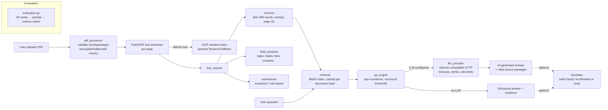

# DocuBharat: Step 1 Research and Architecture Proposal

> **Update (2026-10-29):** The Bhashini route recommended below was implemented in Step 7 and then **removed at the user's request**. AI4Bharat IndicTrans2 now runs **locally** through AI4Bharat's own CTranslate2 inference path (no PyTorch, no compiler). See `docs/integrations.md` and `docs/indictrans2_feasibility.md`.

Research date: 2026-10-29. Every claim below is labelled **Verified** (read on the official page or repo), **Third-party** (from non-official sources only), or **Unverified** (not confirmed).

---

## 1. Local environment (checked on this machine)

| Item | Finding |
|---|---|
| Python | 3.12.10 (the only interpreter the `py` launcher found) |
| RAM | ~15.2 GB usable |
| Tesseract OCR | Not installed |
| Workspace `C:\docubharath` | Empty before this step |

**Decision:** use **Python 3.12**, which is already installed. Both PyMuPDF 2.0 and Streamlit 1.66 require Python ≥ 3.11 (Verified on PyPI), so 3.11 isn't needed.

---

## 2. AI4Bharat models

### 2.1 IndicTrans2 (translation): the most relevant AI4Bharat model
| Field | Finding | Status |
|---|---|---|
| Source | https://github.com/AI4Bharat/IndicTrans2 | Verified |
| License | MIT for code and checkpoints. Data is CC0 or CC-BY-4.0 | Verified |
| Languages | 22 scheduled Indic languages + English (26 language-script codes) | Verified |
| Checkpoints | `ai4bharat/indictrans2-en-indic-1B`, `-indic-en-1B`, `-indic-indic-1B`. Distilled: `indictrans2-en-indic-dist-200M`, `indictrans2-indic-en-dist-200M`, `indictrans2-indic-indic-dist-320M`. RoPE long-context variants (2048 tokens) released Jan 2025 | Verified |
| HF access | **Gated**: you must log in and accept terms before downloading | Verified |
| HF Inference Providers | "Not deployed by any Inference Provider" (en-indic-dist-200M) | Verified |
| Local inference | `transformers` with `trust_remote_code=True` + **IndicTransToolkit** pre/post-processing. Model card warns the pipeline is not supported in transformers v5 | Verified |
| IndicTransToolkit on Windows | v1.1.1: README says it is "not meant/built/tested for Windows". **No Windows wheels**, Cython source build only | Verified |
| dist-200M size | ~0.3B params, F32 → my estimate is ~1.1 GB download and ~1.5–2.5 GB RAM at inference | Size Verified, RAM is an estimate |
| Hosted demo | Web demo at models.ai4bharat.org. **Not a documented public API**; I won't use it | Verified (demo exists) |

### 2.2 IndicXlit (transliteration)
MIT license, ~11M params, 21 languages, word-level only (Verified). The PyPI package `ai4bharat-transliteration` relies on **fairseq**, which is hard to install on Windows/Python 3.12 (fairseq dependency Verified; install difficulty is my assessment). Translation fits a document-QA app better than transliteration. **Not recommended.**

### 2.3 IndicConformer (speech recognition)
MIT, 22 languages, multilingual model is 600M params, needs AI4Bharat's NeMo fork (Verified). It's speech-to-text, so it doesn't apply to PDF understanding. **Out of scope.**

### 2.4 Bhashini (Government of India platform that hosts IndicTrans2)
| Field | Finding | Status |
|---|---|---|
| Call flow | Pipeline Search (optional) → **Pipeline Config** → **Pipeline Compute** | Verified (official gitbook) |
| Config endpoint | `https://meity-auth.ulcacontrib.org/ulca/apis/v0/model/getModelsPipeline` | Verified |
| Auth | `userID` + `ulcaApiKey` headers, found in "My Profile" after registering on the Bhashini/ULCA portal | Verified |
| Usage terms | APIs are for **proof-of-concept** use. Production or charging end users requires contacting Bhashini about paid plans | Verified |
| Compute endpoint, request/response schema, serviceId for IndicTrans2 | Docs pages I could reach did not show them. Community code mentions `dhruva-api.bhashini.gov.in`. AI4Bharat's catalog lists a service ID `ai4bharat/indictrans--gpu-t4` | **Unverified**: must be taken from the config response after you register |
| Quotas / cost for students | Not stated | **Unverified** |

---

## 3. BharatGen / Patram

| Field | Finding | Status |
|---|---|---|
| Model | `bharatgenai/patram-7b-instruct`: vision-language document model (CLIP-style ViT + OLMo-7B), image-text-to-text | Verified |
| Size | Named 7B. Hub metadata says **8B params, BF16** | Verified |
| License | Apache 2.0 | Verified (HF tags) |
| Access | **Gated** (accept terms on HF) | Verified |
| Languages | **English only**. Indian languages "upcoming" | Verified |
| Hosted API | Product page mentions none. HF says "**isn't deployed by any Inference Provider**" | Verified |
| Self-hosting | vLLM / SGLang / Docker documented. Examples use `--gpus all` | Verified |
| Feasibility on your laptop | BF16 weights alone ≈ 16 GB, which is more than your usable RAM. CPU-only generation would be extremely slow even if it fit | **Not feasible** (estimate) |

**Conclusion:** Patram **won't** be integrated, and the app won't claim to use it. The report will document this limitation. Other BharatGen models (Param-1-2.9B-Instruct, Param2-17B, and others) also have no verified hosted endpoint and are too large for comfortable CPU use.

---

## 4. Hosted LLM for Phase 2

| Provider | Free access | API | Notes | Status |
|---|---|---|---|---|
| **Groq** | Free plan, no card (third-party sources) | OpenAI-compatible: `https://api.groq.com/openai/v1/chat/completions`, Bearer key | Official limits page shows Developer-plan limits, e.g. `openai/gpt-oss-20b`: 30 RPM, 1K RPD, **8K tokens/min**. Free-plan numbers are only visible in your console | Models/limits table Verified; free-plan numbers **Unverified** |
| **Google Gemini** (AI Studio key) | Free tier exists, limits are per-project and shown in AI Studio | Native API + an OpenAI-compatibility endpoint | Third-party sources report free-tier cuts in 2025–26 and conflicting numbers. Check the free-tier data-use terms before uploading real documents | Limits **Unverified** |
| Hugging Face Inference Providers | **Free accounts get no monthly credits** (PRO gets $2/month) | OpenAI-compatible router `https://router.huggingface.co/v1` | Pay-as-you-go | Verified |

**Recommendation:** use a single **OpenAI-compatible chat-completions client** (plain `requests`, no SDK) with `LLM_BASE_URL`, `LLM_MODEL`, and `LLM_API_KEY` set in `.env`. Groq is the default because it's free and needs no card. Gemini or any other OpenAI-compatible endpoint works by changing three env vars. The ~8K tokens/min limit means each request must stay small (≈ 3 passages × ~700 words + prompt ≈ 3–4K tokens).

---

## 5. Proposed architecture

**Module responsibilities** (`src/`):

| Module | Responsibility |
|---|---|
| `config.py` | Limits (10 MB, 100 pages, timeouts, top-k), loaded from env with safe defaults |
| `pdf_processor.py` | Validation, PyMuPDF extraction per page, low-text/OCR detection |
| `text_cleaner.py` | Whitespace, hyphenated line breaks, header/footer noise |
| `chunker.py` | Word-window chunks with overlap that keep `page` and `chunk_id` |
| `retrieval.py` | Tokenizer + stopwords, `rank_bm25.BM25Okapi`, normalized relevance score |
| `field_extractor.py` | Rule-based title, organization, dates/deadlines, ₹ amounts, eligibility, contacts, action items. Every field is tagged `source="rule"` |
| `summarizer.py` | Extractive structured summary (purpose, key points, dates, actions, fees/eligibility) |
| `qa_engine.py` | Retrieval → evidence check → extractive answer or LLM answer. Explicit "not found in document" |
| `llm_provider.py` | Provider interface, OpenAI-compatible implementation, `NullProvider` when no key. Timeout, 429 back-off, malformed-response handling. Prompts treat document text as untrusted data |
| `translator.py` (Phase 3) | IndicTrans2 integration behind the same "optional, fail-safe" pattern |
| `evaluation.py` | Runs the 40 test cases and computes field EM, QA accuracy, Hit@3, groundedness, and summary consistency |

The app launches and works fully with **no API key, no model, and no internet** (Phase 1). LLM and translation are opt-in add-ons that fall back cleanly.

---

## 6. Dependency list

Phase 1 core (all small, pure-Python or prebuilt Windows wheels):

| Package | Purpose | Note |
|---|---|---|
| `streamlit` (1.66.x) | UI | Verified latest 1.66.1, Py ≥ 3.11 |
| `PyMuPDF` (**1.28.2**, not 2.0) | PDF text extraction | **License: AGPL-3.0** (see risks). *Step 3 finding:* 2.0 depends on `onnxruntime` + `pymupdf_layout` and loads them on import (6.5 s, ~140 MB RSS). 1.28.2 has no dependencies (0.9 s, ~57 MB) |
| `rank-bm25` | BM25 retrieval | Depends only on numpy |
| `pandas` | Evaluation tables | |
| `requests` | Hosted LLM / Bhashini HTTP | |
| `python-dotenv` | Optional `.env` | |
| `pytest` | Tests | dev |
| `reportlab` *(dev only, optional)* | Generate synthetic sample PDFs | Could use PyMuPDF instead, so I'll probably skip this |

Exact pins will be resolved by `pip` during Step 3 and frozen into `requirements.txt`. I won't hand-guess version numbers.

Estimated install size: ~250–350 MB (mostly Streamlit's dependency tree and pandas/numpy/pyarrow). No torch, no transformers.

**Not included:** LangChain, vector DBs, embedding models, local LLMs, torch, transformers.

---

## 7. Resource and project risks

| Risk | Impact | Mitigation |
|---|---|---|
| PyMuPDF is AGPL-3.0 | Repo license must be AGPL-compatible if distributed | Fine for coursework. I'll license the repo AGPL-3.0 or note it in the README (your call) |
| Scanned PDFs | No text without OCR. Tesseract isn't installed | Detect low text, show a clear "OCR needed" message. Optional Tesseract (UB Mannheim installer, ~50–100 MB) via PyMuPDF's built-in OCR hook, only if you approve |
| Groq/Gemini free-tier limits change or are smaller than expected | 429 errors during the demo | Back-off + user-visible message + extractive fallback. Cache LLM answers per (doc hash, question). Keep payloads ≤ ~4K tokens |
| Sending document text to a third party | Privacy | Send only top-k passages, never the whole document. Use synthetic/public docs in the demo |
| Prompt injection inside PDFs | Model follows document instructions | System prompt marks passages as untrusted data in delimited blocks. Answers must cite passage IDs. Evidence is always shown separately |
| Local IndicTrans2 on Windows | IndicTransToolkit has no Windows wheels and is untested on Windows. Needs torch (~200 MB CPU wheel) + transformers 4.x + ~1.1 GB gated download + ~2 GB RAM | Only behind explicit approval, lazy-loaded on a button press, never at startup. Bhashini preferred if you can register |
| Bhashini endpoint details unverified | Integration may need adjustment once you have keys | Build against the verified config call, read the compute URL and key from its response, and fail safe |
| BM25 misses paraphrased questions | Lower QA accuracy | Document in error analysis. Light query normalization (synonyms for "fee/amount/charges", "last date/deadline") |

---

## 8. Integration choices (summary)

| Component | Choice |
|---|---|
| Generative model | Hosted OpenAI-compatible endpoint. **Groq** recommended, Gemini alternative. Optional, never required |
| AI4Bharat | **IndicTrans2** for translating answers/summaries into Indian languages. Route: **Bhashini hosted API** (preferred) or **local `indictrans2-en-indic-dist-200M`** (opt-in, needs approval) |
| BharatGen Patram | **Not integrated**: no hosted endpoint, gated 8B BF16 model, English-only, infeasible on 16 GB CPU. Documented as a limitation |
| IndicXlit / IndicConformer | Not used: fairseq/NeMo install burden, and not relevant to PDF QA |

## 9. Decisions needed from you before later steps
1. **LLM provider (Step 6):** create a free Groq key (recommended) or a Gemini AI Studio key. Not needed until Step 6.
2. **Translation route (Step 7):** (a) register on Bhashini for `userID`/`ulcaApiKey`, or (b) approve the local IndicTrans2 dist-200M install (torch CPU + transformers 4.x + ~1.1 GB gated download + Windows build risk for IndicTransToolkit), or (c) both, with Bhashini primary.
3. **OCR:** install Tesseract for the optional scanned-PDF fallback, or keep "OCR needed" detection only.
4. **Repo license:** AGPL-3.0 (consistent with PyMuPDF) or another license with a note.

## Sources
- https://github.com/AI4Bharat/IndicTrans2
- https://huggingface.co/ai4bharat/indictrans2-en-indic-dist-200M
- https://pypi.org/project/IndicTransToolkit/
- https://github.com/AI4Bharat/IndicXlit
- https://github.com/AI4Bharat/IndicConformerASR
- https://bharatgen.com/products/patram/
- https://huggingface.co/bharatgenai and https://huggingface.co/bharatgenai/patram-7b-instruct
- https://bhashini.gitbook.io/bhashini-apis and https://bhashini.gitbook.io/bhashini-apis/pipeline-config-call
- https://admin.models.ai4bharat.org/models/ (service ID listing)
- https://console.groq.com/docs/rate-limits
- https://ai.google.dev/gemini-api/docs/rate-limits
- https://huggingface.co/docs/inference-providers/pricing
- https://pypi.org/project/PyMuPDF/ and https://pypi.org/project/streamlit/
- Third-party (unverified) free-tier figures: https://benchlm.ai/md/free-tier/groq.md, https://yingtu.ai/ru/blog/google-gemini-api-free-tier
